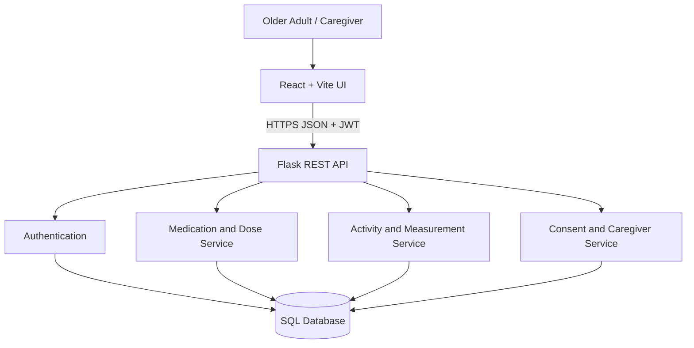
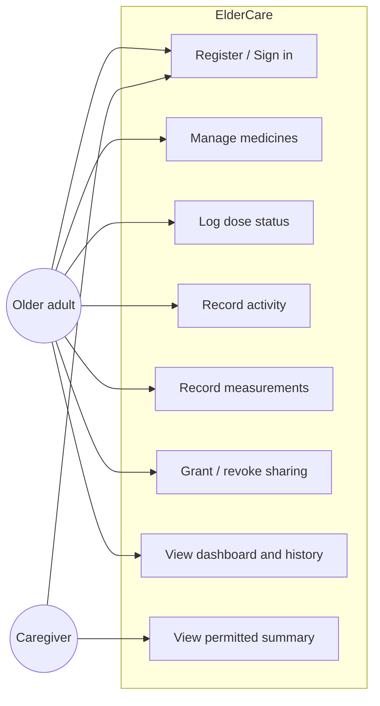
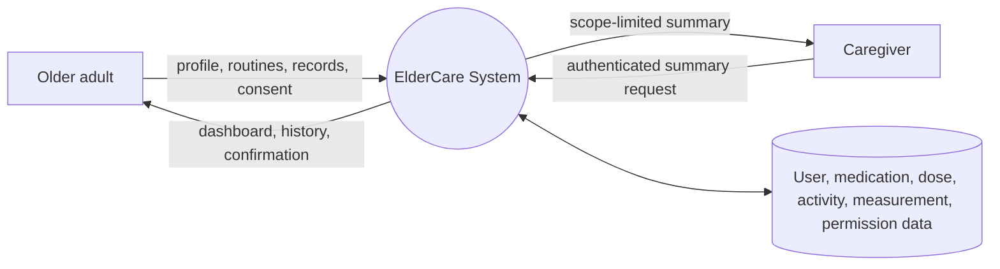
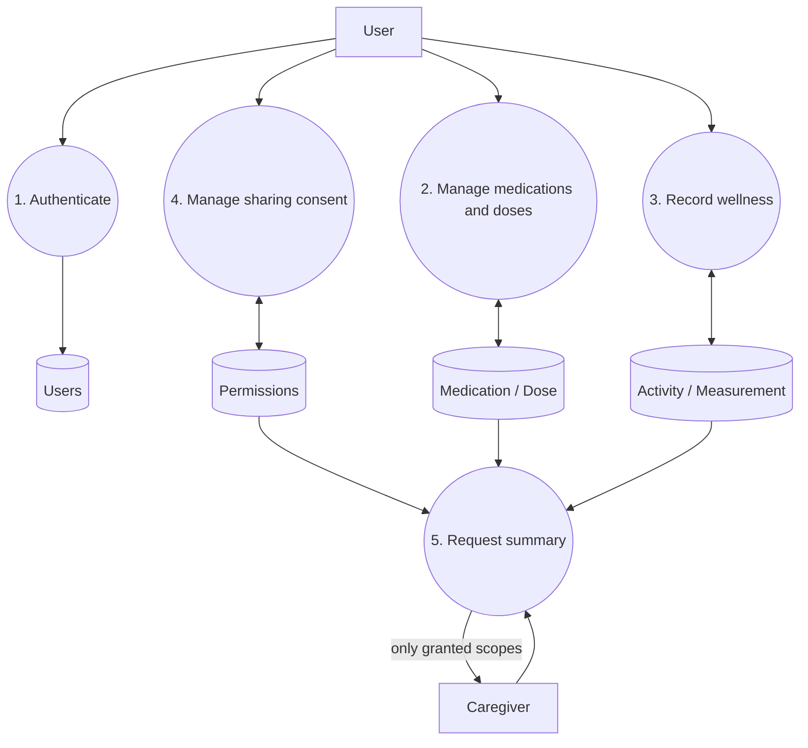
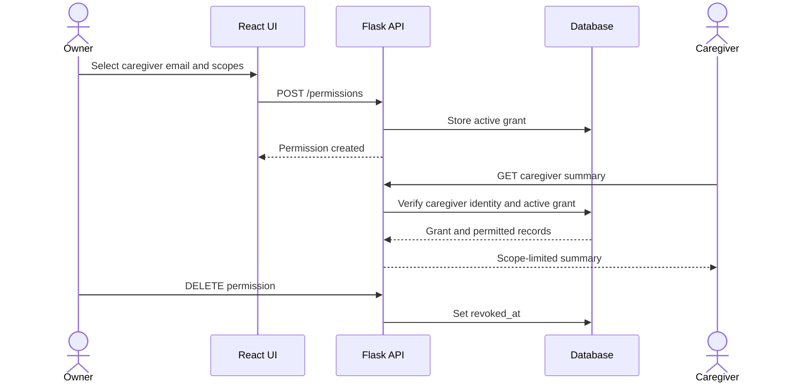
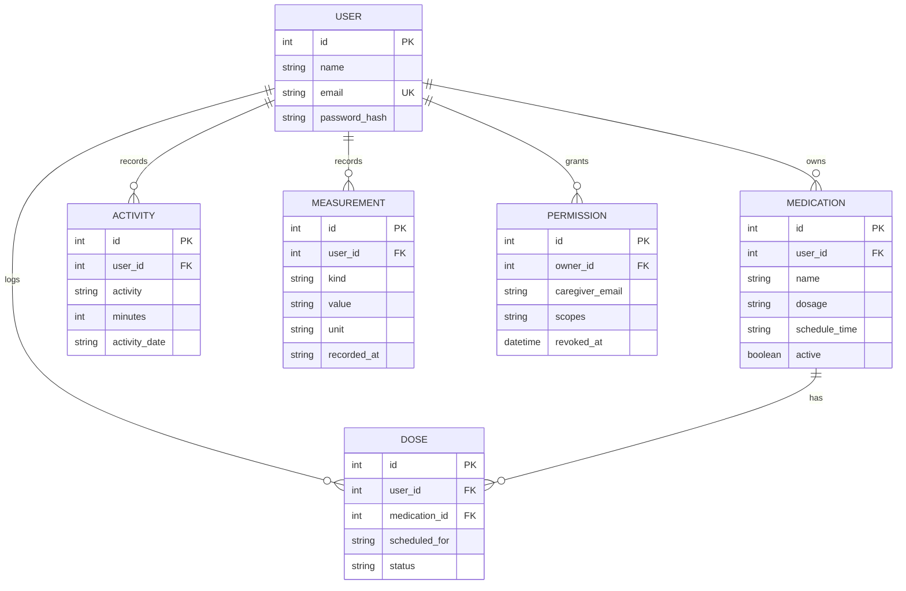

# ElderCare — Milestone 2 Technical Documentation

**Project:** ElderCare — Smart Medication & Wellness Companion for Elderly People Living Alone  
**Institution:** Bennett University, School of Computer Science and Engineering  
**Team:** Gunnidhi Mago, Kritika, Prachi Shoree  
**Guide:** Dr. Sheikh Haque  
**Document status:** Draft for verification against the running MVP

> Evidence integrity: this document describes the supplied implementation. Test outcomes, stakeholder feedback, measured performance and screenshots must be populated only after execution/collection. Do not claim unperformed activities as completed.

## 1. Finalized system requirements

### 1.1 Functional requirements
| ID | Requirement | Acceptance criterion |
|---|---|---|
| FR-01 | Register and sign in | Valid registration creates account; invalid credentials are rejected |
| FR-02 | View personal dashboard | Dashboard shows counts and saved routines |
| FR-03 | Add medication | Name, dosage and HH:MM schedule are stored |
| FR-04 | View medication schedule | Only authenticated owner's medications are returned |
| FR-05 | Edit/delete medication | Owner can update/delete own record; other users cannot |
| FR-06 | Log dose status | Dose can be marked pending, taken, skipped or missed |
| FR-07 | Record activity | Activity name, date and positive duration are stored |
| FR-08 | Record health measurements | Blood pressure, cholesterol or weight value and unit are stored |
| FR-09 | Grant caregiver access | Owner chooses caregiver email and one or more data scopes |
| FR-10 | Revoke caregiver access | Owner can revoke an active grant |
| FR-11 | View caregiver summary | Only matching caregiver with active permission can view selected scopes |
| FR-12 | View personal history | Owner can review stored dose, activity and measurement entries |

### 1.2 Non-functional requirements
| ID | Requirement | Verification approach |
|---|---|---|
| NFR-01 | Usability for older adults | Observe task completion; large controls, plain labels, low-complexity navigation |
| NFR-02 | Responsive interface | Test desktop, tablet and mobile viewport widths |
| NFR-03 | Access control | Test unauthenticated, cross-account and revoked-grant requests |
| NFR-04 | Data integrity | Validate required fields, allowed status values and ownership |
| NFR-05 | Maintainability | Separate React UI, Flask API and SQLAlchemy models |
| NFR-06 | Portability | SQLite local demo; PostgreSQL through DATABASE_URL |
| NFR-07 | Privacy | Sharing is opt-in and scope-limited |
| NFR-08 | Reliability | API errors are returned as clear HTTP responses; execute repeatable tests |

## 2. Architecture and design

The solution uses a three-tier architecture:
1. Presentation: React single-page application, responsive layout and forms.
2. Application: Flask REST API, JWT authentication, validation, ownership checks and consent enforcement.
3. Data: SQLAlchemy relational models using SQLite for local demonstration or PostgreSQL for deployment.

### 2.1 Architecture diagram

### 2.2 Use-case diagram

### 2.3 DFD Level 0

### 2.4 DFD Level 1

### 2.5 Sequence diagram: caregiver access

## 3. Data design

### 3.1 Entity relationship overview

### 3.2 Data dictionary
- **User:** identity and password hash; password is never stored in plaintext.
- **Medication:** owner, medicine name, prescribed dosage, instruction note, local reminder time and active flag.
- **Dose:** owner, medication, scheduled timestamp and status (`pending`, `taken`, `skipped`, `missed`).
- **Activity:** owner, activity label, minutes and date.
- **Measurement:** owner, type, value, unit and timestamp. Values are retained as entered; no diagnosis is inferred.
- **Permission:** owner, caregiver email, selected scopes and revocation timestamp.

## 4. Module/component design
| Module | Responsibility | API |
|---|---|---|
| Authentication | Registration, login, identity | `/api/auth/*`, `/api/me` |
| Dashboard | Aggregated overview | React client aggregation from resource APIs |
| Medication | CRUD medication schedules | `/api/medications` |
| Dose log | Taken/skipped/missed records | `/api/doses` |
| Activity | Daily movement records | `/api/activities` |
| Health journal | Measurement records | `/api/measurements` |
| Consent | Grant and revoke scopes | `/api/permissions` |
| Caregiver summary | Enforce identity and active grant | `/api/caregiver/summary` |

## 5. Technology implementation
- React 18 and Vite for the browser application.
- Flask and Flask-JWT-Extended for REST endpoints and bearer-token authentication.
- Flask-SQLAlchemy for relational persistence.
- Flask-Bcrypt for password hashing.
- SQLite for zero-configuration local evaluation; PostgreSQL is supported by setting `DATABASE_URL`.
- In-app UI is implemented. Actual browser push delivery, service-worker scheduling and background escalation are not yet implemented.

## 6. MVP status
Implemented in supplied source:
- Registration/login and authenticated API access.
- Medication create/list/update/delete API; add/list/delete in UI.
- Dose status logging.
- Activity and measurement recording.
- Consent creation, listing and revocation.
- Caregiver summary API with active-grant and scope checks.
- Responsive React screens.

Not yet complete:
- True scheduled/background push notification delivery and missed-dose escalation.
- Caregiver-facing login/summary screen in the React UI (API exists).
- Automated full integration/security test suite and deployment hardening.
- Usability sessions with older adults and documented stakeholder feedback.
- Production deployment, HTTPS configuration, backups, audit trail and formal privacy/legal review.

## 7. Test plan and test cases
Execute locally and record actual result/date/environment. Suggested cases:
| ID | Test | Expected result | Actual/status |
|---|---|---|---|
| TC-01 | API health | HTTP 200 and status ok | Pending execution |
| TC-02 | Register valid user | HTTP 201 and token returned | Pending execution |
| TC-03 | Register invalid email/short password | HTTP 400 | Pending execution |
| TC-04 | Duplicate email | HTTP 409 | Pending execution |
| TC-05 | Login incorrect password | HTTP 401 | Pending execution |
| TC-06 | Add medication with required fields | HTTP 201 | Pending execution |
| TC-07 | Add medication missing dosage | HTTP 400 | Pending execution |
| TC-08 | User requests another user's medication | HTTP 404 | Pending execution |
| TC-09 | Log dose as taken | Status stored as taken | Pending execution |
| TC-10 | Log invalid dose status | HTTP 400 | Pending execution |
| TC-11 | Add activity with positive minutes | HTTP 201 | Pending execution |
| TC-12 | Add activity with zero minutes | HTTP 400 | Pending execution |
| TC-13 | Add supported measurement | HTTP 201 | Pending execution |
| TC-14 | Create consent grant with scopes | HTTP 201 | Pending execution |
| TC-15 | Caregiver without grant requests summary | HTTP 403 | Pending execution |
| TC-16 | Granted caregiver requests summary | Only granted fields returned | Pending execution |
| TC-17 | Revoke grant then request summary | HTTP 403 | Pending execution |
| TC-18 | Mobile viewport check | No horizontal overflow; controls usable | Pending manual test |

## 8. Validation, performance and accuracy
No performance or accuracy values are asserted in this draft. For the final evaluation:
- Measure API response time over at least 20 repeated requests and report median and 95th percentile, with hardware and dataset size.
- Test data isolation using two separate accounts.
- Test consent enforcement for each scope and after revocation.
- Record browser/device and viewport for responsive testing.
- Medication adherence summary, if calculated, must define its denominator and period. This MVP currently stores dose events; it must not imply clinical adherence or medical accuracy.

## 9. Stakeholder feedback
Conduct short, voluntary task-based sessions with intended users/caregivers only after informed consent. Use fictional data. Suggested tasks: add a medication, log a dose, record a measurement and explain/revoke caregiver access. Record participant role (not identifying details), task completion, observed difficulty and suggested change. Do not invent participant numbers or quotes.

## 10. Updated risk register
| Risk | Likelihood | Impact | Mitigation / evidence |
|---|---|---|---|
| Reminder not delivered while browser closed | High | High | Clearly disclose MVP limitation; implement service worker and server scheduler; test delivery |
| Incorrect medicine details entered | Medium | High | User confirmation, no prescribing, clinician instructions disclaimer |
| Unauthorised health data access | Medium | High | JWT, ownership checks, scope checks, security tests, HTTPS before deployment |
| Caregiver consent misunderstood | Medium | High | Explicit scopes, clear grant screen, revoke control and user testing |
| Database loss | Medium | High | Scheduled backups and restore test before production |
| Low digital literacy/accessibility | Medium | Medium | Large controls, simple labels, task-based testing with older users |
| Deployment/configuration failure | Medium | Medium | Reproducible setup, environment variables, staging smoke tests |
| Scope growth | High | Medium | Prioritise core MVP; defer IoT/AI/voice features |

## 11. Screenshots and demo evidence checklist
Capture real screenshots from the running app:
1. Registration/login.
2. Empty dashboard.
3. Dashboard with sample fictional data.
4. Medication list and dose status.
5. Activity history.
6. Health measurement history.
7. Caregiver permission scopes and revoked state.
8. Mobile responsive layout.
9. API test output and automated test output.

Store them in `evidence/` with date, browser/device, scenario and test ID. No screenshots are fabricated in this package.

## 12. Work completed and remaining
### Completed in this source package
- React/Vite responsive MVP screens and API integration.
- Flask REST backend and relational data models.
- Authentication and core resource endpoints.
- Consent-based caregiver permission and summary endpoint.
- Architecture, use-case, DFD, sequence and ER diagrams.
- Initial test case catalogue, risk register and demo plan.

### Remaining before final evaluation
- Run installation and test suite on the team's actual machines.
- Fix any environment-specific issues and capture genuine screenshots.
- Complete browser push notification scheduling and escalation.
- Build caregiver summary UI.
- Conduct and document stakeholder usability feedback.
- Perform security, access-isolation and responsive testing.
- Measure response times and document reproducible results.
- Deploy securely if required and prepare final demo/presentation.

## 13. Suggested live demonstration (5–7 minutes)
1. Register/sign in with a fictional account.
2. Add one medication with a schedule.
3. Log a dose as taken and show the dose history.
4. Record a short walk and a sample health measurement.
5. Grant selected caregiver scopes.
6. Demonstrate caregiver API access with a separate caregiver account using Postman/curl.
7. Revoke access and show that the same request is denied.
8. Explain current notification limitation and final milestone work remaining.
